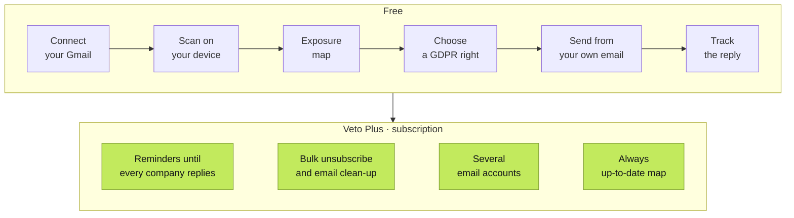

<p align="center">
  <picture>
    <source media="(prefers-color-scheme: dark)" srcset="Logos/Logo%20VETO%20(verde%20-%20dark%20mode).svg">
    
  </picture>
</p>

<p align="center"><strong>Your digital footprint, under your control.</strong></p>

<p align="center">
  <a href="mvp/MVP_SCOPE%20.md">MVP scope</a> ·
  <a href="mvp/ARCHITECTURE.md">Architecture</a>
</p>

---

## What is Veto?

Over the years, we give our personal data to dozens of companies: online shops, banks, apps, airlines, clinics, newsletters we no longer read. Most people could not say who those companies are, let alone what they still keep. The GDPR gives everyone the right to ask, but exercising it means finding the companies, finding the right contact, writing a formal request and chasing the reply. Almost nobody does it.

**Veto does that work for you.** It looks at your email to find the companies that are likely to hold your data, shows them on an exposure map, and prepares the legal request you choose, ready to send from your own mailbox. Then it keeps track of the reply.

## How it works



1. **Connect your Gmail.** You sign in on Google's own screen and give read-only access. Veto never sees your password.
2. **Scan.** Veto reads only the sender, subject and date of your latest emails, and recognises companies from a catalogue and from patterns such as welcome emails, receipts and newsletters.
3. **See your exposure map.** Each company is a dot, grouped by area (health, finance, shopping, travel…) and coloured by how serious it would be if its data leaked.
4. **Choose what to do.** For each company you can ask for a copy of your data (access), for your data in a reusable format (portability), for your data to be deleted (erasure), or for it to stop using your data for marketing (objection).
5. **Send it yourself.** Veto writes the request with the right legal basis and opens it in your own email app. The company replies directly to you.
6. **Follow up.** Veto counts the one-month deadline set by the GDPR and tells you when a request is late.

## Plans

| | Free | Veto Plus |
|---|:---:|:---:|
| Scan and exposure map | ✓ | ✓ |
| GDPR requests drafted for you (access, portability, erasure, objection) | ✓ | ✓ |
| Track requests and their deadlines | ✓ | ✓ |
| News about data leaks and scams involving companies that hold your data | ✓ | ✓ |
| Reminders and follow-ups until every company replies | | ✓ |
| Unsubscribe and delete old emails in bulk | | ✓ |
| Several email accounts in one analysis | | ✓ |
| Continuous analysis: email counts and severity kept up to date | | ✓ |
| **Price** | **€0** | **€2.99/month or €29.99/year** |

Seeing is free, so anyone can understand their exposure and exercise their rights. The subscription pays for the work that never ends: following up, cleaning up and keeping the map current. Veto Plus is not available yet; the prototype measures how many people would subscribe, and at which price, before we build it.

## Privacy

Veto is a privacy app, so it has to hold itself to the same standard it asks of others.

- **Emails downloaded by the app are analysed on the device. Veto does not receive or store emails or exposure maps on its servers.**
- Veto asks Google for read-only access and only requests the sender, subject, date and unsubscribe link of each email, never the body or attachments.
- There is no Veto account. Results stay on your device, and you can delete them at any time.
- Requests are sent from your own email; Veto never acts as an intermediary.
- The prototype only collects anonymous usage statistics if you accept them, to help us validate the idea. The details are in the [privacy policy](https://matildez0.github.io/Veto/mvp/prototipo/privacidade.html) and in [SECURITY_AND_PRIVACY.md](mvp/SECURITY_AND_PRIVACY.md).

## Try it

The web prototype is live at **[matildez0.github.io/Veto/mvp/prototipo](https://matildez0.github.io/Veto/mvp/prototipo/)**.

Veto has not been verified by Google yet, so Google shows a warning before you connect your Gmail. This is expected during testing: choose **Continue** (or **Advanced › Go to Veto**).

To run it on your own computer:

```bash
cd mvp/prototipo
python -m http.server 8000
# open http://localhost:8000
```

Connecting Gmail locally only works if `http://localhost:8000` is registered as an authorised JavaScript origin in the Google OAuth client.

## Repository

| Folder | What it contains |
|---|---|
| [`mvp/prototipo/`](mvp/prototipo/) | Web prototype used for market validation (HTML and JavaScript, runs entirely in the browser) |
| [`mvp/veto-app/`](mvp/veto-app/) | The mobile app, in development (React Native with Expo, TypeScript) |
| [`mvp/`](mvp/) | Project documents: [MVP scope](mvp/MVP_SCOPE%20.md), [product strategy](mvp/PRODUCT_STRATEGY.md), [security and privacy](mvp/SECURITY_AND_PRIVACY.md) and [architecture](mvp/ARCHITECTURE.md) |
| [`Logos/`](Logos/) | The Veto logo for light and dark backgrounds |
| [`Protótipo/`](Prot%C3%B3tipo/) | The first version of the prototype |

## Who we are

Veto is built by a team of students from the **Master's in Informatics Engineering (Mestrado em Engenharia Informática) at the University of Minho**, in Portugal, as part of the Projeto de Informática course (2026/27).

## Acknowledgements

Thanks to **[Startup Braga](https://www.startupbraga.com)**, who helped us refine the idea.
