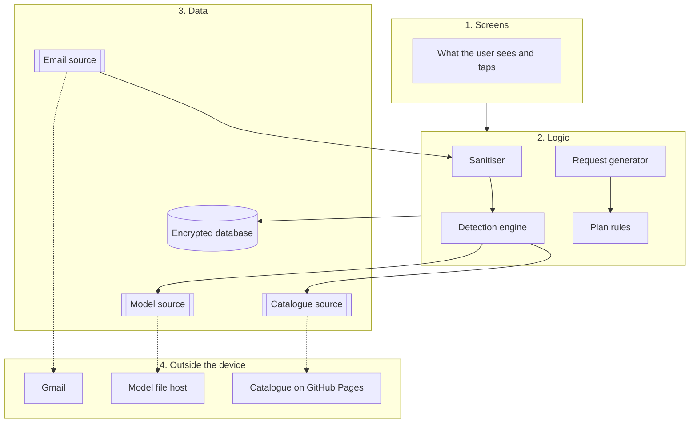
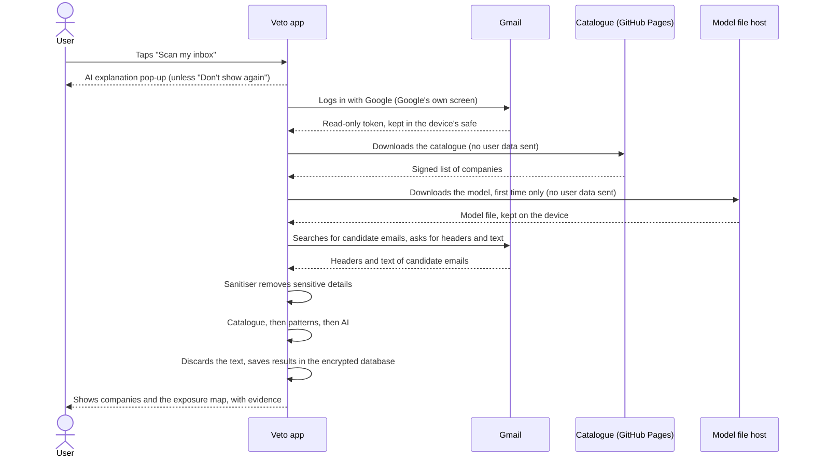

# Veto: Technical Architecture

> Resolves #2 · Status: updated after the October 2026 team meeting, awaiting final review
>
> This document explains how Veto is built: which technologies we use, how the code is organised, and what happens inside the app when the user scans their inbox or prepares a request. It follows the rules set in [MVP_SCOPE.md](MVP_SCOPE.md) and [SECURITY_AND_PRIVACY.md](SECURITY_AND_PRIVACY.md). The data and functions shared between the parts of the app are in [DATA_CONTRACTS.md](DATA_CONTRACTS.md).
>
> **What changed in this version.** The scan reads the text of candidate emails, cleans it on the device and passes it through three detection layers: catalogue, patterns and an on-device AI model. The app has a rule for the daily request limit, Portuguese and English, and a light mode. Section 9 describes the web prototype used with testers.

## 1. The idea in one paragraph

Most apps have a server that stores users' data and does the heavy work. **Veto has no server that receives emails or results.** Everything happens on the user's device: the app talks directly to Gmail, analyses the emails on the device (including with AI), and keeps only the results in an encrypted database on the device. The only things we put online are public files with no user data: the list of companies and their privacy contacts (the catalogue) and the AI model file.

## 2. Technologies

| What | Technology | What it does in Veto |
|---|---|---|
| App | **React Native with Expo**, written in **TypeScript** | One codebase that runs on both iPhone and Android. We chose it because the team already knows React and TypeScript, so the semester goes into building Veto, not learning a new language. |
| Local database | **SQLite** (`expo-sqlite`), encrypted with **SQLCipher** | Stores the results of scans, the requests the user prepared, their dates and notes. Encrypted so that nobody can read it without the key. It never stores email text. |
| Key and token storage | **`expo-secure-store`** | Keeps the database key and the Gmail login token in the device's own safe (Keychain on iPhone, Keystore on Android). |
| Gmail login | **Google OAuth 2.0** (`expo-auth-session`) | The user logs into Google on Google's own screen. Veto never sees the password; for the scan it only receives a token with read-only permission (`gmail.readonly`). Two Veto+ actions ask for one more permission, only at that moment: `gmail.send` to send the same request to several companies, and `gmail.modify` to move a company's emails to the Trash. Those tokens are revoked as soon as the action ends. |
| Reading email | **Gmail API** | The app asks Gmail directly, from the device, for the headers (sender, subject, date, unsubscribe link) and the text of candidate emails. Never attachments. |
| Cleaning the text | **Our own TypeScript code** (the sanitiser) | Converts HTML to plain text and removes verification codes, IBAN, NIF, card numbers and passwords before any rule or model sees the text. |
| Detection: catalogue and patterns | **Our own TypeScript code** (lookups and rules) | Matches the sender against the catalogue and applies rules in Portuguese and English to the subject, sender, unsubscribe link and text. |
| Detection: AI | **A small model running on the device** (model and runtime chosen in D20) | Classifies what the catalogue and patterns could not. Returns only labels from a fixed list. No AI service and no external server is involved. |
| Catalogue and model hosting | **GitHub Pages** for the catalogue; a free public host for the model file (to be chosen) | Serve public files. They never receive user data. |
| Languages | **`expo-localization`** and a translation library | Portuguese and English. The app starts in the device's language. |
| Light and dark mode | React Native's colour scheme (`useColorScheme`) and shared colour tokens | Follows the device's setting; the user can change it. |

## 3. How the code is organised

The app is split into four layers. Each layer has one job and only talks to the layer next to it. This keeps the code easy to test, and it means that a problem in one part (for example, Google login not working) does not block the rest of the team.

**1. Screens.** Everything the user sees: onboarding, the AI explanation pop-up, scan results, the exposure map, request drafts, the list of requests and their deadlines, the News page and the settings (language, light or dark mode, "show the explanations again"). Screens show information and pass on what the user taps. They never read emails or write to the database themselves.

**2. Logic.** The parts that do the real work:
- **Sanitiser.** Receives each email from the email source, keeps the headers and the text part, converts HTML to text and removes sensitive details (codes, IBAN, NIF, card numbers, passwords). The result exists only in memory during the scan.
- **Detection engine.** Groups the emails by company (sending domain) and classifies each company in three layers, in this order:
  1. **Catalogue:** the sender's domain gives the company's name, area and privacy contact.
  2. **Patterns:** rules on the subject, sender, unsubscribe link and text (for example, "Welcome to" or "account created" suggests an account; "Your order" or "invoice" suggests a purchase).
  3. **AI:** for what the first two layers could not classify, the on-device model returns labels from a fixed list (kinds of relationship, area, types of data the company likely holds).

  A company can end up with several kinds (account, purchase, newsletter) or none ("to confirm"). For each company the engine keeps the evidence (sender, subject with codes masked, date), the layer that classified it, the severity (from the area, one level lower when it only sends marketing) and any third party found in the unsubscribe link. Then the email text is discarded.
- **Request generator.** Takes the company, the right the user chose (access, portability, erasure or objection) and the matching legal template in Portuguese or English, and produces the text of the request. It then opens that text as a draft in the email app the user chose, opens the company's web form, or copies the text.
- **Plan rules.** Decide what the current plan allows: on the free plan, up to three requests per day; on Veto+, several accounts, continuous monitoring, bulk deletion, bulk unsubscribe and requests to several companies at once. The request generator asks the plan rules before starting a request.

**3. Data.** Where information comes from and where it is kept:
- **Encrypted database**, with results, requests, the daily request count and the user's settings (including "don't show again"). Never email text.
- **Email source**, which gets email data. In the real app it asks Gmail; in demo mode it reads a simulated inbox stored inside the app.
- **Catalogue source**, which gets the list of companies. In the real app it downloads it from GitHub Pages and checks the signature; in tests it uses a local copy.
- **Model source**, which gets the AI model. In the real app it downloads the model file once, after checking that the device has enough memory, and keeps it on the device; in tests it uses a stand-in that returns fixed labels.

**4. Outside the device.** Only three services: Gmail (which already holds the user's emails), GitHub Pages (which only serves the public catalogue) and the model file host (which only serves the public model).

## 4. What happens during a scan

The emails are analysed in the device's memory. Only the results (company, kinds, severity, evidence, the classifying layer, third party) are saved, and only on the device.

If the device cannot run the model, the model is not downloaded and the AI layer is skipped. The scan still finishes with the catalogue and patterns, and the app says so.

## 5. What happens when the user prepares a request

1. The user picks a company and a right (for example, "erase my data").
2. The plan rules check whether the user still has requests left today. If not, the app says when they can send again and stops here.
3. The request generator fills the legal template with the company's privacy contact.
4. The app opens the draft in the email app the user chose (Gmail, Outlook or the device's email app), or the company's web form. If that fails, the user taps **"Copy request"** and pastes it anywhere.
5. Before leaving, the app saves the request as `awaiting confirmation`.
6. The user sends the email from their own email app. For a single request, **Veto does not send the email**.
7. When the user comes back to Veto, the app notices it returned to the screen and asks **"Did you send this request?"**. If the user dismisses the question, Veto asks again later.
8. If the user says yes, Veto saves the date, shows the 30-day deadline and schedules a reminder on the device.
9. While the request waits for a reply, **"Send again"** opens the same draft again.

**The same request to several companies (Veto+).** The user chooses one right and several companies. Companies that only accept a web form, that have no confirmed contact or that already have that request open are listed apart, with the reason. Veto then shows a preview of everything that will be sent: the account, each recipient, the subject and the text. Only when the user accepts does it ask Google for `gmail.send` (plus the account's email address), check that the account is the one that was scanned, and send one email per company through the Gmail API (`messages.send`), one at a time. Each email Gmail confirms becomes a request with the status `sent` and a 30-day deadline; the ones that fail are shown with the reason and can be retried. The token is revoked at the end.

**Moving a company's emails to the Trash (Veto+).** Veto shows how many emails the company sent and asks for confirmation, with the option to do it by hand in Gmail instead. It then asks Google for `gmail.modify`, checks the account, lists the ids of the emails received from the company's domains and moves them to the Trash in blocks of up to 1000 (`messages.batchModify` with the `TRASH` label), or one by one (`messages.trash`) if the block call fails. Nothing is deleted permanently; the token is revoked at the end.

## 6. Working without Gmail

The **email source**, the **catalogue source** and the **model source** are written as interfaces: a description of what they must provide, with two versions behind each one.

| Part | Real version | Test and demo version |
|---|---|---|
| Email source | Reads from Gmail with the user's permission | Reads a simulated inbox stored in the app |
| Catalogue source | Downloads from GitHub Pages and checks the signature | Uses a local copy |
| Model source | Downloads the model file once and runs it on the device | A stand-in that returns fixed labels, so tests are predictable |

Because the rest of the app does not know which version it is using, the team can build and test the whole app, and give the full demo, without connecting to Gmail or downloading the model. This is what makes Milestone A (demo) and Milestone B (real Gmail) independent, as described in [MVP_SCOPE.md, Section 8](MVP_SCOPE.md#8-acceptance-criteria).

## 7. Packages we plan to use

| Need | Package |
|---|---|
| Moving between screens | `expo-router` (works like routing in Next.js) |
| Google login | `expo-auth-session` |
| Keeping keys and tokens safe | `expo-secure-store` |
| Local encrypted database | `expo-sqlite` with the SQLCipher option |
| Downloading and keeping the model file | `expo-file-system` |
| Running the model on the device | To be chosen with the model (D20) |
| Languages | `expo-localization` and a translation library |
| Light and dark mode | `useColorScheme` from React Native |
| "Copy request" button | `expo-clipboard` |
| Opening the email draft | `Linking` from React Native |
| Knowing the user came back to the app | `AppState` from React Native |
| Deadline reminders | `expo-notifications` (local notifications only) |
| Shared app state | React hooks, or Zustand if needed |

**A practical note.** For quick prototyping, Expo offers an app called Expo Go. It cannot run the encrypted database, the full Google login or an on-device model, so for those the team uses an **Expo development build**, a version of the app built for our own test phones. It is set up once at the start of the project.

## 8. Where AI fits

The team decided that AI is part of every scan, on every plan (decisions D0 and D1 in [MVP_SCOPE.md, Section 10](MVP_SCOPE.md#10-decisions)). It is the third layer of the detection engine, after the catalogue and the patterns.

Rules for the AI layer:

- **On the device only.** The model runs in the app. No email, header or result is sent to an AI service or any other server.
- **Labels only.** The model returns labels from a fixed list (kinds of relationship, area, types of data). It never produces contacts, links or free text. Emails are written by third parties, including scammers, and may contain text designed to manipulate a model; this rule means nothing the model returns can decide where a request is sent. Recipients come only from the catalogue or from the user.
- **Not bundled.** The model is downloaded once, with a size warning in the AI explanation pop-up, after checking that the device has enough memory.
- **Never blocking.** If the model is not available, the scan finishes with the catalogue and patterns, and the companies they could not classify stay "to confirm" for the user to review.
- **No training on Gmail data.** Data obtained through the Gmail API is not used to train or fine-tune models. Check the current wording of Google's user data policy before any training.
- **Measured.** The model is chosen (D20) by comparing candidates on the labelled set from [MVP_SCOPE.md, Section 8](MVP_SCOPE.md#8-acceptance-criteria): accuracy, size and time on a mid-range phone and on a computer.

## 9. The validation prototype (web)

Before the Expo app is ready, testers use a web prototype. It follows the same rules (no server that receives emails or results), but it is built differently:

| What | Prototype | Veto app |
|---|---|---|
| Where it runs | Any browser, on phones and computers, published on GitHub Pages (`mvp/prototipo/`) | iPhone and Android |
| Code | One HTML page and one JavaScript file, styled with Tailwind | React Native with Expo, in TypeScript |
| Gmail login | Google Identity Services in the browser, with `gmail.readonly` for the scan, and `gmail.send` or `gmail.modify` only for the two Veto+ actions. Each token is kept only in memory and revoked as soon as its action ends | `expo-auth-session`, token in the device's safe |
| Scan | Headers of the 500 most recent emails, plus counts per company through Gmail search | Candidate emails selected by Gmail search, headers and text |
| Sending requests | One company: draft in the email app or the company's form. Several companies (Veto+): preview, then the Gmail API | The same |
| Results and requests | The browser's local storage, on that browser only | Encrypted SQLite database |
| Catalogue | Reads `mvp/catalogo/catalogo.json` from the same site when it starts and checks the group's signature with Web Crypto (ECDSA P-256); a changed or unsigned catalogue is not used, and the user confirms every contact | Downloaded from GitHub Pages and checked against its signature |
| AI | Not yet | On-device model |
| Statistics | Optional and anonymous: if the tester accepts, events (for example "scan completed, 60 companies") go to a Google Apps Script that writes them to a Google Sheet. Never email addresses, company names, subjects or content. Requests for tester access (a Gmail address the person types) go to a separate sheet, so the team can add them to the Google test users. | None planned |

The prototype exists to validate the idea and the flow with real inboxes. Its code is the starting point for the logic of the Expo app (see [DATA_CONTRACTS.md](DATA_CONTRACTS.md) for the shared data and the names used in each build).
