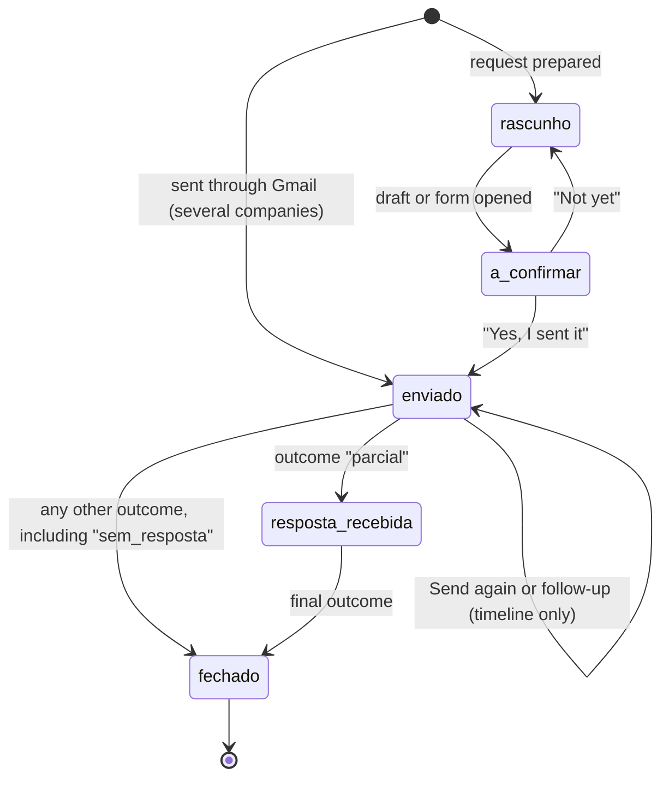

# Veto: Data Contracts

> Resolves #4 · Status: draft awaiting review
>
> This document defines the data, statuses and functions shared by the four workstreams (screens, detection, requests and data), so each one can be built and tested on its own. It follows [MVP_SCOPE.md](MVP_SCOPE.md) and [ARCHITECTURE.md](ARCHITECTURE.md).
>
> The code version of this contract is [`veto-app/src/types/index.ts`](veto-app/src/types/index.ts). When one changes, the other changes in the same pull request.

## 1. Ground rules

- **There is no server API.** Veto has no server that receives emails or results, so the "endpoints" are the functions of the logic layer, called by the screens (Section 6).
- **Email text never leaves memory.** The text of an email exists only during the scan, after the sanitiser has cleaned it. No entity below stores it.
- **The AI returns labels only.** Its output (Section 5) is a fixed set of labels. Contacts always come from the catalogue or from the user.
- **Dates** are ISO 8601 strings (`2026-10-20T09:30:00.000Z`). The daily request count uses the local date (`2026-10-20`).
- **Identifiers** in code are in English; values shown in this contract keep the Portuguese names already used in the Expo app. Section 10 maps them to the names in the web prototype.

## 2. Shared values

| Type | Values | Notes |
|---|---|---|
| `RelationKind` | `conta_provavel`, `compra`, `newsletter` | A company can have several. An empty list means "to confirm" (`por_confirmar` in filters). |
| `Sector` | `saude`, `financas`, `encontros`, `comida`, `viagens`, `lazer`, `social`, `servicos`, `educacao`, `publico`, `compras`, `outros` | The areas of the exposure map. |
| `Severity` | `critica`, `alta`, `media`, `baixa` | Comes from the area; one level lower when the company only sends marketing. |
| `DetectionLayer` | `catalogo`, `padrao`, `ia`, `utilizador` | Which layer classified the company. `utilizador` when the user changed or added it. |
| `DataType` | `contacto`, `morada`, `pagamento`, `identificacao`, `saude`, `localizacao`, `historico_compras`, `perfil` | Types of data the company probably holds. |
| `ReviewStatus` | `pendente`, `confirmado`, `descartado` | `descartado` is "I have no data here". |
| `RequestType` | `acesso`, `portabilidade`, `apagamento`, `oposicao` | Articles 15, 20, 17 and 21 of the GDPR. |
| `RequestStatus` | `rascunho`, `a_confirmar`, `enviado`, `resposta_recebida`, `fechado` | See Section 4. |
| `RequestOutcome` | `dados_recebidos`, `dados_apagados`, `oposicao_aceite`, `sem_dados`, `recusado`, `parcial`, `sem_resposta` | Recorded by the user. |
| `ContactChannel` | `email`, `formulario`, `ambos` | How the company accepts requests. |
| `EmailApp` | `gmail`, `outlook`, `sistema` | Where the draft opens. |
| `Language` | `pt`, `en` | Interface and request templates. |
| `Theme` | `sistema`, `escuro`, `claro` | Follows the device by default. |
| `Plan` | `gratuito`, `veto_plus` | Read by the plan rules. |
| `ExplanationId` | `aviso_ia`, `apagar_emails`, `terceiros`, `cartao_veto_plus` | Pop-ups that accept "Don't show again". |

## 3. Entities

These are kept in the encrypted local database. None of them stores email text.

### UserPreferences

| Field | Type | Meaning |
|---|---|---|
| `hasCompletedOnboarding` | boolean | The user has seen the onboarding. |
| `appLockEnabled` | boolean | App lock with biometrics or PIN. |
| `language` | `Language` | Interface and default template language. |
| `theme` | `Theme` | Dark, light or follow the device. |
| `hiddenExplanations` | `ExplanationId[]` | Pop-ups hidden with "Don't show again". Emptied by "Show the explanations again". |
| `emailApp` | `EmailApp`, optional | The email app chosen the first time a draft was opened. |
| `plan` | `Plan` | Current plan. |

### EmailAccount

| Field | Type | Meaning |
|---|---|---|
| `id` | string | Internal identifier. |
| `address` | string | The Gmail address, used to open drafts in the right account. Stays on the device. |
| `provider` | `'gmail'` | Only Gmail in the MVP. |
| `connectedAt` | date | When it was connected. |
| `lastScanAt` | date, optional | Last scan of this account. |

The free plan has one account; Veto+ allows several.

### CatalogCompany

| Field | Type | Meaning |
|---|---|---|
| `id` | string | Usually the main domain. |
| `name` | string | Brand name, as it appears in emails (for example, "Netflix"). |
| `legalName` | string, optional | Legal name of the controller, used in the request (for example, "Netflix International B.V."). |
| `domains` | string[] | Domains the company sends email from. |
| `sector` | `Sector` | Area on the map. |
| `channel` | `ContactChannel` | How it accepts requests. |
| `privacyEmail` | string, optional | Required when `channel` is `email` or `ambos`. |
| `webFormUrl` | string, optional | Required when `channel` is `formulario` or `ambos`. |
| `privacyUrl` | string | Page where the contact was published. |
| `verifiedAt` | date | When the contact was last checked: by the team, or the last change of the record at the source. |
| `origin` | `'veto'`, `'datenanfragen'` | Where the record comes from. |
| `originId` | string, optional | The record's identifier at the source (the Datenanfragen slug). |
| `notes` | string, optional | What the user needs to know: other channels, what to choose in a form, the policy date. |

### DetectedService (a company found in the scan)

| Field | Type | Meaning |
|---|---|---|
| `id` | string | Main domain of the company. |
| `catalogCompanyId` | string, optional | Link to the catalogue; empty if the company is not in it. |
| `customName` | string, optional | Name from the sender or typed by the user. |
| `domains` | string[] | Sending domains grouped into this company. |
| `accountIds` | string[] | Accounts where it appears. |
| `sector` | `Sector` | Area. |
| `kinds` | `RelationKind[]` | Kinds of relationship; empty means "to confirm". |
| `classifiedBy` | `DetectionLayer` | Layer that decided the kinds. |
| `severity` | `Severity` | Colour and size on the map. |
| `dataTypes` | `DataType[]` | Data the company probably holds. |
| `userReviewStatus` | `ReviewStatus` | The user's review. |
| `thirdParty` | `{ domain, name }`, optional | Service that sends emails for the company, found in the unsubscribe link (for example, Mailchimp). |
| `unsubscribeUrl` | string, optional | Only `https:` or `mailto:` links. |
| `unsubscribedAt` | date, optional | When the user unsubscribed through Veto. |
| `cleanup` | `{ at, count }`, optional | The last time Veto moved this company's emails to Gmail's Trash, and how many (Veto+). |
| `stats` | object | `emailsInScan`, `totalReceived`, `sentByUser`, `firstDate`, `lastDate`. |
| `evidence` | `Evidence[]` | A few examples, each with `accountId`, `senderEmail`, `subjectMasked` (codes replaced by `•••`), `receivedDate`, `layer` and, for patterns, the `rule`. |

Leaks and scams from the News page are not stored here: the screens look them up by domain and show them as neutral text in the company's details.

### PrivacyRequest

| Field | Type | Meaning |
|---|---|---|
| `id` | string | Internal identifier. |
| `detectedServiceId` | string | The company. |
| `accountId` | string | Account the request is sent from. |
| `requestType` | `RequestType` | The right. |
| `language` | `Language` | Template language. |
| `status` | `RequestStatus` | See Section 4. |
| `outcome` | `RequestOutcome`, optional | What the company did. |
| `channel` | `'email'`, `'formulario'`, `'copiado'` | How it left Veto. |
| `sentBy` | `'utilizador'`, `'veto'` | `utilizador`: the user sent it from their email app or the form. `veto`: Veto sent it through Gmail, in a request to several companies. |
| `batchId` | string, optional | The sending it belongs to, when it went to several companies at once. |
| `companyContactUsed` | string | Email or form address used. |
| `createdAt` | date | When it was prepared. |
| `sentAt` | date, optional | When the user said it was sent, or when Gmail confirmed it (`sentBy: 'veto'`). |
| `expectedResponseDate` | date, optional | `sentAt` + 30 days; the user can adjust it. |
| `replyAt`, `closedAt` | date, optional | When the reply was recorded and when the request was closed. |
| `confirmationPostponed` | boolean, optional | The user dismissed "Did you send this request?" without answering. |
| `timeline` | `{ type, at }[]` | Every change of status, plus `reenviado` ("Send again") and `insistencia` (follow-up). |

### DailyRequestCount

| Field | Type | Meaning |
|---|---|---|
| `date` | `YYYY-MM-DD` | Local date. |
| `count` | number | Requests confirmed as sent that day. The free plan allows 3. |

### ScanSummary

| Field | Type | Meaning |
|---|---|---|
| `id`, `accountId` | string | The scan and the account. |
| `startedAt`, `finishedAt` | date | Duration of the scan. |
| `emailsAnalysed` | number | Candidate emails read. |
| `companiesFound` | number | Companies in the results. |
| `aiUsed` | boolean | False if the device could not run the model. |
| `unknownBeforeAi`, `unknownAfterAi` | number | Companies "to confirm" before and after the AI layer. |

## 4. Request statuses



- The daily limit is checked before `a_confirmar`; the count goes up when the request reaches `enviado`.
- Dismissing "Did you send this request?" sets `confirmationPostponed` and keeps `a_confirmar`; the question comes back later.
- `expectedResponseDate` is set when the request reaches `enviado`.
- A request sent by Veto to several companies starts directly in `enviado`: Gmail confirms the sending, so there is nothing to ask. A sending that fails creates no request.

## 5. Sources

Each source is an interface with a real version and a test version (see [ARCHITECTURE.md, Section 6](ARCHITECTURE.md#6-working-without-gmail)).

**EmailSource**

| Function | Returns | Notes |
|---|---|---|
| `findCandidateIds(accountId, sinceDate)` | `string[]` | Gmail search for candidate emails (D5 sets the period). |
| `getEmail(accountId, id)` | `SanitizedEmail` | Headers and text, already cleaned. Never attachments. |
| `countEmails(accountId, query)` | number | Counts by paging through ids only. |

`SanitizedEmail` has `id`, `accountId`, `from` (`name`, `address`, `domain`), `subject`, `date`, `listUnsubscribe` and `text`. It exists only in memory.

**CatalogueSource**: `load()` returns `CatalogCompany[]` (Section 7).

**ModelSource**

| Function | Returns | Notes |
|---|---|---|
| `isSupported()` | boolean | Checks memory and runtime support. |
| `downloadSizeBytes()` | number | Shown in the AI explanation pop-up. |
| `ensureDownloaded(onProgress)` | — | Downloads once and keeps the file on the device. |
| `classify(input)` | `AiLabels` | Input: `senderName`, `domain`, `subjects`, `textSnippets` (all cleaned). Output: `kinds`, optional `sector`, `dataTypes`, `confidence` (0 to 1). Labels only. |

## 6. Logic functions (the local "API")

| Workstream | Function | Returns | What it does |
|---|---|---|---|
| Data | `connectAccount()` | `EmailAccount` | Google login and account record. |
| Data | `disconnectAccount(accountId)` | — | Revokes the token and removes that account's results. |
| Detection | `scanMailbox(mode, accountId?, onProgress?)` | `ScanSummary` | Runs the scan (`gmail` or `demo`), reporting progress for the live log. |
| Detection | `getDetectedServices(filter?)` | `DetectedService[]` | Filter by kind (or `por_confirmar`), area and account. |
| Detection | `reviewService(serviceId, status)` | — | Confirm, or "I have no data here", or restore. |
| Detection | `updateKinds(serviceId, kinds)` | — | The user changes the kinds; `classifiedBy` becomes `utilizador`. |
| Detection | `addServiceManually(name, domain, sector)` | `DetectedService` | A company the scan missed. |
| Requests | `canStartRequest()` | `{ allowed, remainingToday, nextAvailableAt? }` | Plan rules: 3 per day on the free plan. |
| Requests | `generateDraftText(serviceId, type, language)` | `{ subject, body, contact, channel }` | Fills the template. |
| Requests | `prepareRequest(serviceId, type, language)` | `PrivacyRequest` | Saves the request as `a_confirmar` before leaving the app. |
| Requests | `markRequestAsSent(requestId)` | `PrivacyRequest` | "Yes, I sent it": sets `sentAt` and the deadline. |
| Requests | `previewBatch(serviceIds, type, language)` | `BatchPreview` | What a request to several companies will send: the account, each recipient with its contact, the subject and an example text, plus the companies left out and why (`formulario`, `sem_contacto`, `aberto`). Sends nothing. |
| Requests | `sendBatch(preview, onProgress?)` | `{ sent: PrivacyRequest[], failed: { serviceId, reason }[] }` | Veto+. Called only after the user accepts the preview. Asks for `gmail.send`, checks the account, sends one email per company and revokes the token. |
| Requests | `markRequestAsNotSent(requestId)` | `PrivacyRequest` | "Not yet": back to `rascunho`. |
| Requests | `postponeConfirmation(requestId)` | — | The question was dismissed. |
| Requests | `resendRequest(requestId)` | `PrivacyRequest` | "Send again": opens the same draft, adds `reenviado`. |
| Requests | `createFollowUp(requestId)` | `{ subject, body }` | Follow-up draft citing Article 12, adds `insistencia`. |
| Requests | `recordOutcome(requestId, outcome)` | `PrivacyRequest` | Records the reply and moves the status (Section 4). |
| Screens | `getPreferences()` / `updatePreferences(changes)` | `UserPreferences` | Language, theme, email app, app lock. |
| Screens | `hideExplanation(id)` / `resetExplanations()` | — | "Don't show again" and "Show the explanations again". |
| Data | `moveEmailsToTrash(serviceId, onProgress?)` | `{ moved: number }` | Veto+. Asks for `gmail.modify`, checks the account, moves the emails received from the company to Gmail's Trash and revokes the token. Sets `cleanup`. |
| Data | `deleteEverything()` | — | Deletes all local data and revokes the Gmail token. |

## 7. Catalogue file

Served from GitHub Pages as `catalogo.json` and signed, so the app can check it has not been changed: `catalogo.json.sig` holds an ECDSA P-256 signature (SHA-256, base64) of the file's text with `\n` line endings, made with the group's private key by `catalogo/assinar.mjs`. The public key is in `catalogo/catalogo.pub.json` and built into the app; a catalogue that fails the check is not used. It is generated by `catalogo/importar_datenanfragen.py` from the [Datenanfragen.de](https://github.com/datenanfragen/data) database (CC0 1.0) and from the Portuguese companies checked by the team (`catalogo/empresas_pt.json`); see [catalogo/README.md](catalogo/README.md).

```json
{
  "version": 1,
  "generatedAt": "2026-10-20T09:00:00+00:00",
  "sources": [
    { "name": "Datenanfragen.de company database", "url": "https://github.com/datenanfragen/data", "license": "CC0-1.0", "commit": "aba6474…", "records": 682 },
    { "name": "Veto team (Portuguese companies)", "url": "empresas_pt.json", "records": 24 }
  ],
  "companies": [
    {
      "id": "edp.pt",
      "name": "EDP",
      "legalName": "EDP Comercial – Comercialização de Energia, S.A.",
      "domains": ["edp.pt", "edp.com"],
      "sector": "servicos",
      "channel": "email",
      "privacyEmail": "dpo.pt@edp.com",
      "privacyUrl": "https://www.edp.pt/media/2167/politica-de-privacidade_05jan.pdf",
      "verifiedAt": "2026-10-20",
      "origin": "veto",
      "notes": "Email do Encarregado de Proteção de Dados, indicado para exercer direitos."
    }
  ]
}
```

Each entry uses the contact published by the company and the page where it was found.

## 8. Usage statistics (web prototype only)

Sent only if the tester accepts anonymous statistics. They never include email addresses, company names, subjects or email content.

**Format.** The prototype sends a batch of events to the Google Apps Script:

```json
{
  "eventos": [
    {
      "codigo": "ANONIMO",
      "dispositivo": "random id created on this browser",
      "evento": "analise_concluida",
      "detalhes": { "emails": 182, "empresas": 77, "porGravidade": { "critica": 14, "alta": 24 } },
      "quando": "2026-10-20T09:30:00.000Z",
      "versao": "prototipo-0.8"
    }
  ]
}
```

**Events.**

Every event also carries `ecra` (`telemovel` for touch screens, `computador` otherwise) and, when the link had one, `origem`.

| Event | Details |
|---|---|
| `adesao` | `vista`, `origem` (from `?origem=` in the link) |
| `app_aberta` | `vista`, `diasDesdeAdesao` (once per day) |
| `pagina_vista` | `vista` (once per page per day, after the first) |
| `login_google_interrompido` | `motivo`: `janela_fechada`, `janela_bloqueada`, `acesso_negado` or `outro` |
| `analise_concluida` | `emails`, `empresas`, `duracaoS`, `porGravidade`, `porArea`, `porTipo`, `semTipo`, `noCatalogo`, `comCancelamento`, `comTerceiro` |
| `analise_falhou` | `motivo`: `api_desativada`, `sem_permissao`, `quota`, `rede`, `sessao_expirada` or `outro` (never the error text) |
| `pedido_preparado` | `direito`, `area`, `gravidade`, `canal` (`email` or `formulario`), `contacto` (`veto`, `datenanfragen`, `utilizador`), `vista` |
| `pedido_enviado` | `direito`, `area`, `canal`, `app` (`veto_lote` when Veto sent it to several companies), `minutos` since it was prepared |
| `pedido_reenviado` | `direito`, `area` |
| `resposta_registada` | `direito`, `area`, `resultado`, `dias` since it was sent |
| `subscricao_cancelada` | `area`, `gravidade` |
| `contacto_indicado` | `area`, and `onde: 'lote'` when typed in a request to several companies |
| `lote_aberto` | `onde` (where the user opened «Pedir a várias empresas») |
| `lote_revisto` | `direito`, `pedidos` (the preview was shown) |
| `lote_enviado` | `direito`, `pedidos` (sent), `falhados`, `onde` |
| `lote_interrompido` | `motivo`: `autorizacao` (Google permission not given) or `conta` (a different account was chosen) |
| `apagar_aberto`, `apagar_no_gmail`, `apagar_interrompido` | `area` |
| `emails_apagados` | `area`, `quantos`, `metodo` (`lote` or `um_a_um`) |
| `guia_aberto`, `noticia_aberta`, `faq_aberta` | the question or news item |
| `plus_visto`, `plus_aberto`, `plus_quero`, `plus_agora_nao` | `onde`, and `plano` for `plus_quero` |
| `opiniao` | `nota`, `comentario` |
| `saida` | — (the tester turned statistics off) |
| Planned: `limite_atingido`, and `semIa` in `analise_concluida` | For the daily limit and scans without AI. |

**Reading the results.** The Apps Script keeps the `Eventos` sheet as it arrives and rebuilds three sheets from it (menu Veto › Atualizar as folhas, or an hourly trigger): `Resumo` (the test questions, each with its numbers and a plain explanation), `Pessoas` (one row per device: how far it got in the five steps of the test, and what it did) and `Histórico` (one row per action, in Portuguese, newest first). Text that comes from the app is always written as text, never as a formula.

**Tester access requests** use a separate message, `{ "pedidoAcesso": { "email", "quando", "versao" } }`, stored in another sheet so the team can add the address to the Google test users. It is the only place where an email address reaches the team, and only because the person typed it to ask for access.

## 9. Examples

**A detected company**

```json
{
  "id": "edp.pt",
  "catalogCompanyId": "edp.pt",
  "domains": ["edp.pt"],
  "accountIds": ["acc-1"],
  "sector": "servicos",
  "kinds": ["compra", "newsletter"],
  "classifiedBy": "padrao",
  "severity": "alta",
  "dataTypes": ["contacto", "morada", "pagamento"],
  "userReviewStatus": "pendente",
  "thirdParty": { "domain": "mktomail.com", "name": "Marketo" },
  "unsubscribeUrl": "https://info.edp.pt.mktomail.com/unsubscribe",
  "stats": { "emailsInScan": 6, "totalReceived": 84, "sentByUser": 6, "firstDate": "2021-03-02T10:00:00.000Z", "lastDate": "2026-10-12T08:15:00.000Z" },
  "evidence": [
    {
      "accountId": "acc-1",
      "senderEmail": "faturas@edp.pt",
      "subjectMasked": "A tua fatura nº ••• está disponível",
      "receivedDate": "2026-10-12T08:15:00.000Z",
      "layer": "padrao",
      "rule": "fatura"
    }
  ]
}
```

**A request waiting for a reply**

```json
{
  "id": "req-7",
  "detectedServiceId": "edp.pt",
  "accountId": "acc-1",
  "requestType": "apagamento",
  "language": "pt",
  "status": "enviado",
  "channel": "email",
  "sentBy": "utilizador",
  "companyContactUsed": "dpo.pt@edp.com",
  "createdAt": "2026-10-19T21:02:00.000Z",
  "sentAt": "2026-10-19T21:05:00.000Z",
  "expectedResponseDate": "2026-11-18T21:05:00.000Z",
  "timeline": [
    { "type": "rascunho", "at": "2026-10-19T21:02:00.000Z" },
    { "type": "a_confirmar", "at": "2026-10-19T21:02:00.000Z" },
    { "type": "enviado", "at": "2026-10-19T21:05:00.000Z" }
  ]
}
```

## 10. Names in the web prototype

The web prototype (`mvp/prototipo/app.js`) uses English keys. When moving its logic to the Expo app, map them like this:

| Contract | Prototype |
|---|---|
| `conta_provavel`, `compra`, `newsletter`, empty list | `likely_account`, `purchase`, `newsletter`, `unknown` |
| `acesso`, `portabilidade`, `apagamento`, `oposicao` | `access`, `portability`, `erasure`, `objection` |
| `rascunho`, `a_confirmar`, `enviado`, `resposta_recebida`, `fechado` | `draft`, `awaiting_confirmation`, `sent`, `reply_received`, `closed` |
| `dados_recebidos`, `dados_apagados`, `oposicao_aceite`, `sem_dados`, `recusado`, `parcial`, `sem_resposta` | `data_received`, `data_erased`, `objection_accepted`, `no_data`, `company_refused`, `partial`, `no_reply` |
| `userReviewStatus: 'descartado'` | `dismissed: true` |
| `Sector` and `Severity` values | Same keys |
| `confirmationPostponed` | `perguntaAdiada` |
| `sentBy: 'veto'`, `batchId` | `via: 'veto'`, `lote` |
| `cleanup: { at, count }` | `limpeza: { em, quantos }` |

The prototype keeps one kind per company in `kind` plus the full list in `evidence.kinds`; the contract keeps only `kinds`.

## 11. Who owns what

| Workstream | Owns | Depends on |
|---|---|---|
| Screens | Everything the user sees, `UserPreferences`, the pop-ups and their "Don't show again" | The functions in Section 6 |
| Detection | Sanitiser, catalogue and pattern layers, AI layer, `DetectedService`, `ScanSummary` | `EmailSource`, `CatalogueSource`, `ModelSource` |
| Requests | Templates, `PrivacyRequest`, plan rules, `DailyRequestCount` | `DetectedService`, catalogue contacts |
| Data | Encrypted database, Gmail login, sources, "Delete everything" | — |

Any change to a type in this document needs the agreement of the workstreams that depend on it.
