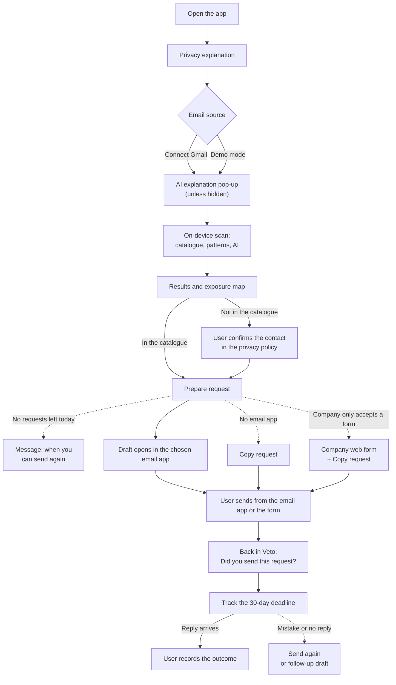

# Veto: MVP Scope

> Closes #1 · Status: updated after the October 2026 team meeting, awaiting final review · Scope freeze: end of Phase 0
>
> This is one of five documents:
> - **MVP_SCOPE.md** (this file): what we build this semester, what stays out, how we know it works and what is still to be decided.
> - [PRODUCT_STRATEGY.md](PRODUCT_STRATEGY.md): personas to validate, competition, monetisation, business customers, desktop and the Personal Data Map.
> - [SECURITY_AND_PRIVACY.md](SECURITY_AND_PRIVACY.md): data flow, OAuth permissions, local storage, threat model and the plan for a public launch.
> - [ARCHITECTURE.md](ARCHITECTURE.md): technologies, how the code is organised, and what happens inside the app.
> - [DATA_CONTRACTS.md](DATA_CONTRACTS.md): the data, states and functions shared by the four workstreams.
>
> **What changed in this version.** The scan now reads the text of candidate emails, not only their headers. Detection uses the catalogue, pattern recognition and an on-device AI model in every scan, on every plan, with an explanation pop-up that can be hidden. The free plan allows three requests per day. The Veto+ features are defined. The interface will have Portuguese and English, and a light mode. Requests cover four rights and use a 30-day deadline. Section 12 lists what the validation prototype already does.

## 1. Vision

Personal data is scattered across the services people use and others they may have already forgotten about. People have rights over that data, but exercising them means identifying the companies involved, finding the right contact, preparing the requests and following up on the replies. As more services collect and use personal data, this work becomes increasingly hard to manage.

Veto is an app that brings all these steps together in a single guided process. It scans the user's inbox to suggest companies they may have dealt with, matches them against a curated directory of privacy contacts and shows them on an exposure map. The user reviews each result, chooses a right (access, portability, erasure or objection to marketing) and sends the request from their own email. Veto then tracks what happens next.

Veto is designed to keep this process private. **Emails downloaded by the app are analysed on the device. Veto does not receive or store emails or exposure maps on its servers.** There is no Veto account. The user decides which companies to act on, which requests to send and what to keep on the device.

### What makes Veto different

- **It finds the companies for you.** Request generators assume you already know who has your data; Veto starts from your own inbox.
- **No Veto server stores your inbox or your results.** The scan, including the AI step, runs on the device and there is no account.
- **Requests go out from your own email.** Companies reply to you directly; Veto never acts as an intermediary.
- **Honest results.** Each company comes with its evidence and with the step that classified it (catalogue, pattern or AI), and each status shows who determined it.
- **Built for Portugal first**, with local companies, Portuguese templates and references to the CNPD.

The full comparison with Mine, data broker removal services and request generators is in [PRODUCT_STRATEGY.md](PRODUCT_STRATEGY.md#3-competition-and-what-makes-veto-different).

## 2. Initial audience for the semester

The MVP is aimed at Gmail users in Portugal who have built up accounts with many services. We work with three user groups (university students, privacy-conscious adults and adults with forgotten accounts). What we believe about each group is still a **hypothesis** to be tested in the Phase 1 interviews, not confirmed behaviour. The full descriptions, and the questions each interview has to answer, are in [PRODUCT_STRATEGY.md](PRODUCT_STRATEGY.md#2-personas-hypotheses-to-validate).

## 3. How Veto works, in one paragraph

Veto exists in two builds. The **validation prototype** is a web app published on GitHub Pages, which works on phones and computers and is used with testers now. The **Veto app** is a cross-platform mobile app built with React Native (Expo). In both, the user grants read-only access to Gmail. The app downloads candidate emails from Google (their headers and text, never attachments), removes sensitive details from the text and analyses it on the device with the catalogue, pattern rules and an on-device AI model. Only the results are kept, in local storage on the device; the email text is discarded. To send a request, Veto opens the user's own email app with a draft already prepared. To send the same request to several companies (Veto+), Veto shows every email first and, once the user accepts, sends them through Gmail from the user's own mailbox. Veto hosts only public files with no user data (the company catalogue and the AI model) and, in the prototype, an endpoint for anonymous statistics that testers choose to share. The technologies and code structure are in [ARCHITECTURE.md](ARCHITECTURE.md); the full data flow, permissions and protections are in [SECURITY_AND_PRIVACY.md](SECURITY_AND_PRIVACY.md).

## 4. In scope

**Onboarding.** Open the app, read a short screen explaining what Veto does with data, and get started. There is no sign-up. The user can turn on an app lock that uses the device's own biometrics or PIN. Onboarding also states clearly that the history stays only on this device and is lost if the device is lost or replaced (see Section 9).

**Email source.**
- Real Gmail connection with the OAuth scope `gmail.readonly`, called directly from the device. In the MVP, this only works for the team and invited testers, because the Google project is in Testing mode.
- **Candidate emails selected within Gmail itself.** Veto does not download the whole inbox and filter it afterwards. It uses Gmail search (the `q` parameter) to request only the emails that may point to a relationship with a company: sign-up, purchase and subscription keywords in Portuguese and English, Gmail's own categories (Purchases, Updates, Promotions) and the time period set in D5. The search runs on Google's servers, which already hold the emails. This saves time, battery and Gmail API quota.
- **Headers and text of each candidate email.** For each result, the app downloads the headers (sender, subject, date, unsubscribe link) and the text part. Attachments and images are never downloaded. HTML is converted to plain text.
- **Sensitive details removed before analysis.** Verification codes, IBAN, NIF, card numbers and passwords are removed from the text before any rule or model sees it. The email text is kept only in memory during the scan and is never stored, logged or sent anywhere.
- Optional cleanup for one detected company: Veto opens a pre-filtered Gmail search and the user moves the received emails to Gmail's Trash. With Veto+, Veto moves them itself (see "Plans" below).
- **Expired connections handled clearly.** In Testing mode, authorisation expires after about seven days. When this happens, the app does not show a technical error but a simple message ("Your Gmail connection expired for security. Tap to reconnect.") and keeps all local history intact.
- Demo mode with a simulated inbox containing realistic messages from Portuguese and international services. It needs no login and is the main path for the pitch.

**Detection.** Detection has three layers, applied in this order in every scan and on every plan:

1. **Catalogue.** The sender's domain is matched against the company catalogue, which gives the company's name, area and privacy contact.
2. **Pattern recognition.** Rules applied to the subject, the sender, the unsubscribe link and the email text (for example, "Welcome to" or "account created" suggests an account; "Your order" or "invoice" suggests a purchase; an unsubscribe link with nothing else suggests marketing). Rules exist in Portuguese and English.
3. **On-device AI.** A small model running on the device classifies what the first two layers could not, and completes the information about each company. It returns only labels from a fixed list (kinds of relationship, area, types of data the company is likely to hold). It never produces contacts, links or free text, and nothing it returns can decide where a request is sent.

A company can have **more than one kind of relationship** at the same time:

| Kind | Typical evidence | What it tells the user |
|---|---|---|
| `likely account` | Welcome email, sign-up confirmation, password reset | You probably have an account with this company |
| `purchase` | Receipt, order confirmation, invoice | You bought something; the company holds data about the purchase |
| `newsletter` | Marketing emails only | The company has your email address; there is no proof that you have an account |
| `unknown` ("to confirm") | Sender recognised, but no layer found a kind | Something links you to this company; review the result |

- In the app, the filters read "You have an account", "You bought", "You get marketing" and "No clear kind".
- For each result, Veto shows the evidence it used (sender, a subject with any codes masked, date) and which layer classified it, so the user can judge it.
- The user can mark a company as "I have no data here", restore it, change its kinds, or add a company manually.

**AI explanation pop-up.** Before a scan, a pop-up explains in plain language that Veto uses AI on the device to understand the relationship with each company, repeats the privacy sentence, and says that the AI can be wrong and how to correct it. It has a **"Don't show again"** option, stored on the device and resettable in the settings. Until the model has been downloaded, the pop-up always shows the download size, even if "Don't show again" was chosen.

**When the model cannot run.** The model is not bundled with the app: it is downloaded once, with a warning about its size. On devices that cannot run it (not enough memory, or a browser without the required support), the scan still finishes with the catalogue and the patterns, and the app says so.

**Exposure map.**
- Each company is a dot, grouped by area (health, finance, dating, shopping, travel and so on). The map scales to hundreds of companies and supports zoom; names appear when zoomed in.
- Colour and size show the **severity** if the company's data leaked: critical, high, medium or low. Severity comes from the area, one level lower when the company only sends marketing.
- Selecting a company shows its **third parties**: services that process data on the company's behalf, such as the email platform identified from the unsubscribe link (for example, Mailchimp).
- **Known data leaks and scams** involving the company, from the News page, appear only as neutral text in the company's details. They are never highlighted on the map.

**News and guide.** A page with a short guide (why it matters to know which companies hold your data, what happens when data is sold or shared, how erasure reaches third parties under Article 19, scams and consequences) and real cases of leaks, fines and scams, each with its source.

**Company catalogue.**
- At least twenty companies relevant to Portuguese users.
- Each entry has the company name, the sending domains it uses, its area, the published privacy contact, the URL of the page where that contact was published and the date the team last checked it.
- Each entry also states **the channel the company accepts**: email, web form (with the form address, `webFormUrl`) or both. Some large companies, such as Meta, Google or Amazon, route privacy requests to their own forms instead of an email address.
- In the app, a catalogue contact appears as **"contact published by the company, checked on [date]"**, never as a guarantee that the request will be delivered or accepted. The user can always edit the recipient before the draft opens.
- Companies outside the catalogue appear as "contact not verified", with a link to the company's privacy policy, so the user can find and confirm the contact.

**Requests.**
- Four legally reviewed templates: access (Article 15), portability (Article 20), erasure (Article 17) and objection to marketing and profiling (Article 21), in Portuguese and English.
- Veto fills in the template with the chosen right and the contact, and opens the draft in the email app the user chooses (Gmail, Outlook or the device's email app). The choice is remembered.
- If the company only accepts requests through a web form, Veto does not generate an email: it opens the company's form and offers "Copy request", so the user can paste the text into the form.
- A **"Copy request"** button is always available for when there is no working email app or the draft does not open correctly.
- **Daily limit on the free plan: three requests per day.** The app shows how many are left ("2 of 3 requests today"). The fourth request of the day does not start, and the message says when the user can send again. A request that has already started is never blocked halfway.

**Tracking.**
- Statuses with a clear source: `draft`, `awaiting confirmation`, `sent (indicated by user)`, `reply received (indicated by user)`, `closed`.
- When the user marks a request as sent, Veto records the date and counts **30 days** for the reply (the one-month deadline in Article 12(3) of the GDPR). The user can adjust it.
- Requests are shown in two groups: **Waiting for a reply** and **Completed**.
- **"Send again"** on every request that is waiting for a reply, for when the user made a mistake or wants to insist. It opens the same draft again.
- When a reply arrives, the user records the outcome: data received, data erased, objection accepted, company says it holds no data, request refused, partial reply, or no reply within the deadline.
- A local reminder when the deadline passes without a reply having been recorded.
- **The "Did you send this request?" question is never lost.** Before opening the email app or the form, Veto saves that the request is awaiting confirmation. If the system closes Veto in the meantime, the app asks the question again when it reopens. If the user dismisses the question by tapping outside it, Veto carries on and asks again later.

**Reducing manual effort** (see Section 9).
- When the user returns to Veto after the draft opens, Veto asks "Did you send this request?", answered with a single tap.
- Batch mode: choose several companies and one right, then go through the drafts one by one (within the daily limit).
- Deadline reminders that ask "Did the company reply?", with one-tap answers.
- A follow-up draft for overdue requests, reminding the company of Article 12 and the date of the original request.
- A "report a missing company" button.
- A short in-app guide explaining what a company's data export usually contains.

**Interface.**
- Portuguese and English. The app starts in the device's language and the user can change it.
- Dark mode and light mode. The app follows the device's setting and the user can change it.

**Plans.**
- **Free:** the whole main flow (scan with AI, exposure map, requests, tracking, news), with up to three requests per day.
- **Veto+** (planned price around €1.99 per month, to be confirmed after the presentation; D18):
  - several email accounts in one analysis;
  - continuous monitoring, which checks the inbox again and shows new companies;
  - bulk email deletion: the user chooses a company and Veto moves all the emails received from it to Gmail's Trash, where they stay for 30 days. Veto shows the number of emails first. This needs the `gmail.modify` scope, requested only at that moment and revoked when the cleanup ends;
  - bulk unsubscribe from newsletters, using each company's own unsubscribe link;
  - requests to several companies at once: the user chooses one right and several companies, Veto shows a preview of exactly what will be sent (account, recipients, subject and text), and only after the user accepts does it send one email to each company through Gmail (D24). This needs the `gmail.send` scope, requested only at that moment and revoked when the sending ends.
- In the MVP, a **Veto+ card** describes the plan and its price and records how many testers would subscribe. It does not charge anything. When each Veto+ feature is built is still open (D23).

**Privacy and security.**
- A transparency screen that describes, in plain language, what the app reads (headers and text of candidate emails), what it stores (results only) and what leaves the device (nothing from the emails).
- "Delete everything" in a single action: it deletes the local data and revokes the Gmail token.
- The local protections described in [SECURITY_AND_PRIVACY.md](SECURITY_AND_PRIVACY.md#5-local-storage-and-threat-model) (encrypted database, no backups of Veto data, protected screens, no sensitive content in logs).
- In the validation prototype, anonymous usage statistics are sent only if the tester accepts them. They never include email addresses, company names, subjects or email content.

## 5. Out of scope

- Any external AI service that receives content or metadata from the user's emails.
- Training or fine-tuning a model with data obtained from users' Gmail accounts.
- Automatic discovery of privacy contacts for companies outside the catalogue (scraping web pages, guessing addresses, DNS checks).
- Email providers other than Gmail, and importing email files (`.mbox`, `.eml`). Planned for after the MVP; Outlook comes with the Veto+ "several accounts" feature.
- Sending emails from Veto's own infrastructure. Requests always leave from the user's own mailbox (D2).
- Automatically reading companies' replies.
- Complaints to the CNPD and other escalation flows.
- Automatically filling in companies' privacy web forms. Veto opens the right form and the user pastes in the request text.
- Backing up, syncing or transferring the history to another device (see Section 9).
- Charging for Veto+ (payments). The plan is defined, but in the MVP the Veto+ card only measures interest.
- A native desktop app (the web build already works on computers), a browser extension, and importing from password managers.
- Any features for companies (business-to-business).
- Zero-knowledge attribute proofs. Future vision only.
- Public distribution beyond Google's list of test users (see [SECURITY_AND_PRIVACY.md](SECURITY_AND_PRIVACY.md#8-requirements-before-a-public-launch)).

## 6. Main user flow

1. Open the app and read a brief explanation of what Veto does with data.
2. Choose the email source: connect Gmail (invited testers only) or start demo mode.
3. Unless the user chose "Don't show again", the AI explanation pop-up appears. The user continues.
4. Veto downloads the candidate emails and analyses them on the device: catalogue, then patterns, then AI. Only the results are kept.
5. The results appear as a list and as an exposure map, each company with its kinds, evidence, severity and the layer that classified it. The user confirms, marks "I have no data here", changes the kinds or adds companies.
6. For a chosen company, the user selects a right. If requests are left for today, Veto prepares the draft with the correct template and the contact, which the user can edit.
7. The draft opens in the user's email app, or the user copies the request if there is no working email app. If the company only accepts a web form, Veto opens that form and the user pastes the text into it. That is where the user sends it.
8. Back in Veto, the app asks "Did you send this request?". The user confirms and Veto shows the deadline, 30 days later.
9. When a reply arrives, the user records the outcome. If something went wrong, or the company does not reply, the user can send the request again or send a follow-up.

## 7. What "sending" actually means

For a request to one company, Veto does not send the email. It prepares the request and opens the user's email app with the draft ready, or lets the user copy it. The request is only delivered when the user taps send in their email app.

Veto cannot see whether that happened, which is why the status only changes to `sent (indicated by user)` when the user confirms it.

For the same request to several companies (Veto+), Veto sends the emails itself, through the Gmail API and from the user's own mailbox, so they appear in the user's Sent folder and the companies reply to the user directly. Before anything is sent, Veto shows every recipient, the subject and the text, and the user accepts. Veto then asks Google for permission to send email at that moment, checks that the account is the one that was scanned, sends the emails one at a time and revokes the permission. Each email that Gmail confirms becomes a request with the status `sent`; one that fails is listed with the reason and can be retried. The GDPR gives companies one month from receipt of the request, extendable in certain cases. Veto counts 30 days from the date the user marks as sent, and the user can adjust it.

The path "open draft → send → return to Veto → mark as sent" is the most fragile moment in the product, because it passes through an app Veto does not control. It has to be tested on iPhone and on Android, with the default email apps and with Gmail as the email app, and also with no email app set up (which is where "Copy request" comes in). It also has to be tested for the case where the system closes Veto while the user is in the email app: on returning, the "Did you send this request?" question must still appear.

## 8. Acceptance criteria

The MVP has **two independent milestones**. Each one is demonstrated separately, so that a problem with Google OAuth never hides the state of the rest of the product, and so that a working demo never hides an unfinished Gmail integration.

### Milestone A: complete demo with the simulated inbox

1. A user opens the app, reads the privacy explanation and starts demo mode. No account is created.
2. The AI explanation pop-up appears before the scan. With "Don't show again" chosen, it does not appear on the next scan, and it can be turned back on in the settings.
3. The results appear with their kinds (a company can have several), evidence, severity and the layer that classified them, both as a list and on the exposure map.
4. The user prepares a request for a company in the catalogue. The contact appears as "published by the company, checked on [date]" and can be edited.
5. The draft opens in the email app on an iPhone and on an Android phone. "Copy request" works when no email app is available. For a company that only accepts a web form, Veto opens the correct form.
6. Returning to Veto brings up the question "Did you send this request?", even if the system has closed Veto in the meantime, and the request then shows its 30-day deadline.
7. The fourth request in the same day does not start, and the message says when the user can send again.
8. The interface works in Portuguese and English, and in dark and light mode.
9. "Delete everything" deletes all local data in a single action.
10. Someone from outside the team completes the whole flow without help.

### Milestone B: real Gmail on a real device

1. An invited tester connects their Gmail account on a physical phone, through the OAuth consent screen.
2. The scan selects candidate emails using Gmail search, downloads their headers and text (no attachments) and produces classified results. The scan time on a real inbox is measured; the target is set after the first tests.
3. Codes, IBAN, NIF and card numbers in test emails never appear in the app, and no email text is found in the local database or in the logs.
4. The AI step runs on a compatible phone. On a phone that cannot run the model, the scan still completes with the catalogue and patterns, and the app says so.
5. Disconnecting Gmail, or using "Delete everything", revokes the token, and this is verified in the tester's Google account settings.
6. When the authorisation expires (Testing mode), the app shows the simple expired-connection message, and reconnecting works without losing the local history.

### Quality measures

Recognising a sender is not the same as being useful. Besides the number of recognised senders, we measure:

- **Confirmation rate:** of the suggestions shown to testers, how many they confirm, by kind.
- **"I have no data here" rate:** how many suggestions testers dismiss because they are wrong or not relevant, by the layer that classified them.
- **"To confirm" rate:** how many companies are left without a kind, before and after the AI step.
- **Manual additions:** how many companies testers add by hand, which shows what the scan misses.
- Results on a labelled set of at least 100 real emails from the team's inboxes, collected with consent, including small Portuguese shops. The same set is used to choose the AI model (D20).

The targets for these measures are set after the first round of testers, once there is data to base them on.

### Catalogue and templates

- At least twenty companies, each with its contact, source URL and the date it was checked.
- Templates for the four rights in Portuguese and English, reviewed against the GDPR articles they cite.

Explicitly not goals: guaranteeing a reply from any company, automatically reading replies, and automatic follow-ups sent without the user.

## 9. Known limitations and how we address them

The "When" column uses three values: **MVP** (built this semester), **Post-MVP** and **Accepted** (a deliberate trade-off, explained to the user).

### User friction and manual effort

| Limitation | What we do | When |
|---|---|---|
| **Manual sending.** The user sends from their email app and comes back to Veto. | The "Did you send this request?" question on return, answered with a single tap. "Copy request" as a fallback. | MVP |
| **Many requests are repetitive.** | Batch mode goes through several drafts in a row, within the daily limit. | MVP |
| **Manual updates to reply status.** | Reminders near the deadline asking "Did the company reply?", with one-tap answers. | MVP |
| **The scan may produce an unhelpful map.** The catalogue is small, companies use several sending domains, users may have deleted old emails, and a newsletter does not prove that an account exists. | Several kinds per company, evidence and the classifying layer shown for every result, the AI step for what the rules miss, manual additions, and the confirmation rate measured with testers (Section 8). The catalogue is prioritised by the companies that appear most often in testers' inboxes and in the interviews. | MVP |
| **Some companies only accept requests through a web form.** | The catalogue records the form (`webFormUrl`); Veto opens it and the user pastes in the request with "Copy request". Tracking works the same way. | MVP |
| **Companies outside the catalogue need a manual contact.** | A link to the company's privacy policy and a "report a missing company" button. Later, users can choose to share only the company's domain and the confirmed contact (no user data), so the team can verify it and add it. | MVP (button), Post-MVP (optional sharing) |

### AI and email content

| Limitation | What we do | When |
|---|---|---|
| **The AI can be wrong.** | Evidence and the classifying layer are shown for every result; the user can mark "I have no data here" or change the kinds; the model only returns fixed labels; its accuracy is measured on the labelled set. | MVP |
| **Emails are written by third parties, including scammers, and can try to manipulate the model.** | The model never produces contacts, links or free text. Recipients come only from the catalogue or from the user. | MVP |
| **Reading the text of emails is more sensitive than reading headers.** | Analysis only on the device, sensitive details removed before analysis, text never stored or logged, and the pop-up and transparency screen explain it. | MVP |
| **The model is large and not every device can run it.** | It is downloaded once, with a size warning; devices that cannot run it use the catalogue and patterns only. | MVP |

### No guaranteed outcomes

| Limitation | What we do | When |
|---|---|---|
| **Companies may not reply.** | "Send again" and a follow-up draft for overdue requests, citing Article 12. | MVP |
| **A verified contact may stop working.** A contact verified on a given date may change or be rejected later. | Show the date it was checked, let the user edit the recipient, and re-check the catalogue before each release. | MVP |
| **No escalation to the CNPD.** | Post-MVP: an exportable summary of the request history and a link to the CNPD complaints page, so the user can file the complaint themselves. | Post-MVP |
| **Data exports are hard to read.** | An in-app guide in the MVP; assisted reading is a possible paid feature. | MVP (guide) |
| **Users may expect a guaranteed outcome.** | Onboarding states clearly that Veto helps people exercise their rights and does not control what companies do. | Accepted |

### Data, platform, and devices

| Limitation | What we do | When |
|---|---|---|
| **The history is lost when the device is lost or replaced.** With no account and no server, there is no copy anywhere else. | Accepted for the MVP, and stated clearly in onboarding and on the "Delete everything" screen. Post-MVP: an encrypted export file that the user creates, stores and imports on a new device, protected by a password only they know. | Accepted (MVP), Post-MVP (export) |
| **The daily limit lives on the device.** Without a server or an account, it can be bypassed by clearing the app's data. | Accepted: the limit guides use, it does not enforce it. | Accepted |
| **Gmail only.** | Post-MVP: Outlook through Microsoft Graph, as part of Veto+ several accounts, and importing email files (`.mbox`, `.eml`). | Post-MVP |
| **Computers.** | The web build already works on computers. A native desktop app is not planned for the MVP (see [PRODUCT_STRATEGY.md](PRODUCT_STRATEGY.md#5-platform-strategy)). | MVP (web), Post-MVP (native) |
| **Large inboxes make the scan slow and run into Gmail API limits.** Downloading the text makes each email heavier than headers alone. | Search within Gmail itself so only candidate emails are fetched, batched requests, a limited time period (D5) and visible progress during the scan. | MVP |
| **The system may close Veto while the user is in the email app.** | The pending request is saved before leaving, and the "Did you send this request?" question appears on reopening. | MVP |
| **Real Gmail limited to testers.** | Milestone A does not depend on Gmail; Milestone B is tested separately (Section 8). | MVP |

## 10. Decisions

### Decided

| # | Decision | Choice | Why |
|---|---|---|---|
| D0 | Is AI part of the product? | **Yes, in every scan.** Decided at the October 2026 team meeting. The course assessment does not require it. | Rules and the catalogue leave many companies without a kind, especially small Portuguese shops. AI on the device fills that gap without sending anything to a server. |
| D1 | Detection technology | **Catalogue, pattern recognition and an on-device AI model, in this order, in every scan and on every plan.** No external AI service. | The catalogue and patterns are fast, predictable and easy to explain, so they go first. The model handles what they miss. It is **not bundled with the app**: it is downloaded once, after checking that the device has enough memory. If the device cannot run it, the scan still works. |
| D2 | How requests are sent | **From the user's own mailbox**: a draft in their email app, plus "Copy request". Requests to several companies at once are sent through Gmail after a preview the user accepts (D24). | Veto never sends from its own infrastructure. The request comes from the person the data belongs to, and the company replies to them directly. |
| D3 | Contacts for companies outside the catalogue | **The catalogue plus a contact the user confirms** in the company's privacy policy. | Automatic guessing could send a request to a wrong or non-existent address, and the user would believe it had been delivered. A contact verified by the user is slower but reliable. "Report a missing company" helps the catalogue grow. |
| D6 | Cross-platform framework | **React Native (Expo) with TypeScript.** | The team already knows React and TypeScript. See [ARCHITECTURE.md](ARCHITECTURE.md). |
| D7 | Google OAuth during the semester | **Testing mode**, with the team and invited testers. | No Google review is needed during testing. Testers see an "unverified app" warning and re-authorise about once a week, which fits with connecting for each scan. Milestones A and B stay independent. Google verification is mandatory before any public launch (see [SECURITY_AND_PRIVACY.md](SECURITY_AND_PRIVACY.md#8-requirements-before-a-public-launch)). |
| D10 | What the scan reads | **Headers and text of candidate emails**, analysed on the device. No attachments. | The text shows the relationship much better than the subject alone (an account created, a delivery address, a customer number). Sensitive details are removed before analysis and the text is never stored. The scope stays `gmail.readonly`. |
| D11 | Explaining the AI | **A pop-up before the scan, with "Don't show again".** | People should know that AI reads their emails on the device, without being asked the same thing on every scan. |
| D12 | Requests on the free plan | **Up to three per day.** | Spreads use over time and keeps people coming back to follow their requests. |
| D13 | Veto+ features | **Several email accounts, continuous monitoring, bulk email deletion and bulk unsubscribe**, plus requests to several companies at once (added in October 2026). | They save time and keep working after the first scan, while the main flow stays free. In the prototype test, bulk deletion and requests to several companies are open to everyone and marked Veto+. |
| D14 | Reply deadline shown | **30 days from the date the user marks as sent.** | Matches the one-month deadline in Article 12(3); the user can adjust it. |
| D15 | Rights covered | **Access, portability, erasure and objection to marketing.** | Objection is the quickest way to stop marketing without deleting an account. |
| D16 | Interface | **Portuguese and English; dark and light mode.** | Reaches people who do not use Portuguese, and respects each person's device settings. |
| D17 | Where leaks and scams appear | **Only as neutral text in the company's details**, never highlighted on the map. | Gives the information without alarming the user or turning the map into a list of threats. |
| D24 | Sending the same request to several companies | **Sent automatically through the Gmail API**, after an in-app preview that the user accepts. One email per company, one at a time, from the scanned account only. | Writing to many companies one by one is the slowest part of the flow. The preview keeps the user in control: nothing leaves without the user seeing who receives what, and from which account. Google still shows its own permission screen once per sending, because Veto asks for `gmail.send` only then and revokes it afterwards. |

### Still open

| # | Decision | Options | Proposal |
|---|---|---|---|
| D4 | Phase 1 interviews | Students only. All three groups. | Three interviews per group (nine in total), plus one or two data protection officers. |
| D5 | Time period of emails scanned | One year. Five years. All. | Five years by default; the user can extend it. Confirm in the first real Gmail tests that a five-year scan takes an acceptable amount of time, now that the text is downloaded too; if not, reduce the default. |
| D8 | Legal review of the templates | A contact at UMinho. An external lawyer. CNPD guidance. | Contact UMinho in Phase 2; check against CNPD guidance. |
| D9 | History when the device is lost or replaced | Accept the loss. Encrypted export file. Cloud sync. | Accept the loss in the MVP and warn the user. An encrypted, user-controlled export file after the MVP. No cloud sync. |
| D18 | Veto+ price | €1.99 per month. Another value. | €1.99 per month is the most likely; confirm after the presentation, together with an annual price. |
| D19 | Limit on Veto+ | No limit. A higher limit per day or per month. | Likely a higher limit per day or per month, to keep people coming back. Set the value with the price. |
| D20 | Which on-device model | A small classifier. A small language model. | Compare two or three candidates on the labelled set (accuracy, size, time on a mid-range phone and on a computer) and choose the smallest one that is good enough. |
| D21 | Can the user turn the AI off? | Always on. Off in the settings. | Decide after the first tests with the pop-up. |
| D22 | Does "Send again" count towards the daily limit? | Yes. No. | Decide together with D19. |
| D23 | When the Veto+ features are built | This semester. After the MVP. | Decide after the presentation, based on how many testers choose Veto+ on the interest card. |
| D25 | Requests to several companies and the daily limit | Veto+ only. Free plan too, with each email counting towards the three per day. | Veto+ only, since sending to many companies at once is the point of the feature; decide with D19. |

Decisions about the future (desktop, monetisation, business customers) are in [PRODUCT_STRATEGY.md](PRODUCT_STRATEGY.md#9-post-mvp-decisions).

## 11. Semester cost

**Infrastructure.** Effectively zero. The catalogue is hosted on GitHub Pages, and the AI model file is served from a free public host (to be chosen). The validation prototype is also on GitHub Pages, and its optional anonymous statistics go to a Google Apps Script and a Google Sheet, both free. There is no server that receives emails or results, and no paid AI service.

**Testing.** Zero for Android testing (direct APK installation). An iPhone test build needs an Apple Developer account (99 USD per year) or the free but limited development provisioning on a team member's device; the team decides in Phase 0. Publishing to the app stores is not planned for this semester.

**Other.** Development time, at least one iPhone and one Android phone for testing (at least one of them able to run the AI model, and one older phone to test the fallback) and time for the legal review of the templates.

## 12. Where the validation prototype stands

The web prototype (`mvp/prototipo/`, published on GitHub Pages) is what testers use now. It already has:

- Gmail connection with `gmail.readonly` and a scan of the headers of the 500 most recent emails, with a live log of what is happening, and real email counts per company through Gmail search.
- The company catalogue (`mvp/catalogo/catalogo.json`, signed by the group so that a changed copy is not used, about 700 companies: the Datenanfragen.de database plus Portuguese companies checked by the team), read when the app starts. Each contact shows where it comes from and when it was checked; companies with a web form get the form, with the request text copied. Outside the catalogue, the user confirms the contact in the company's privacy policy before the request. Pattern rules on the subject, sender and unsubscribe link; codes in subjects are masked.
- Several kinds per company, with the four filters, "I have no data here" and "Why this company?".
- The exposure map with areas, severity colours, zoom, third parties, and leaks only in the company's details.
- Requests for the four rights, the choice of email app, "Did you send this request?" (dismissed by tapping outside), the 30-day deadline, "Send again", follow-up drafts and outcomes.
- The News page with the guide, real cases and frequently asked questions about the app (what it reads, what it stores, which Google permissions it asks for and when, what it sends, where contacts come from, deadlines, price).
- The Veto+ interest card (still showing €2.99 and the old feature list).
- Opt-in anonymous statistics and tester access requests, collected in a Google Sheet.
- A layout for computers, with a collapsible side menu.
- Two Veto+ features, open to everyone during the test and marked Veto+: requests to several companies at once (choose a right and companies, preview, then automatic sending through Gmail with `gmail.send`), and moving all the emails of one company to Gmail's Trash (`gmail.modify`). Each permission is requested at that moment, the account is checked against the scanned one, and the token is revoked at the end.

Still to do, from the decisions above: reading the email text, the AI step and its pop-up, the daily limit, more Portuguese companies in the catalogue, Portuguese and English, light mode, the updated Veto+ card, and the other Veto+ features (several accounts, continuous monitoring, bulk unsubscribe).
